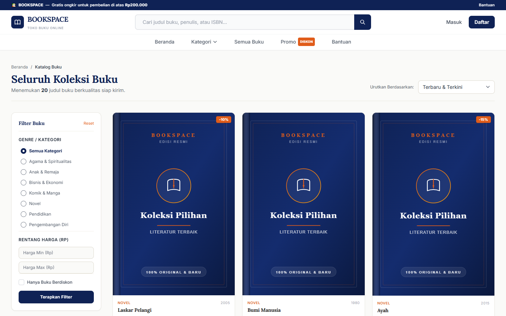
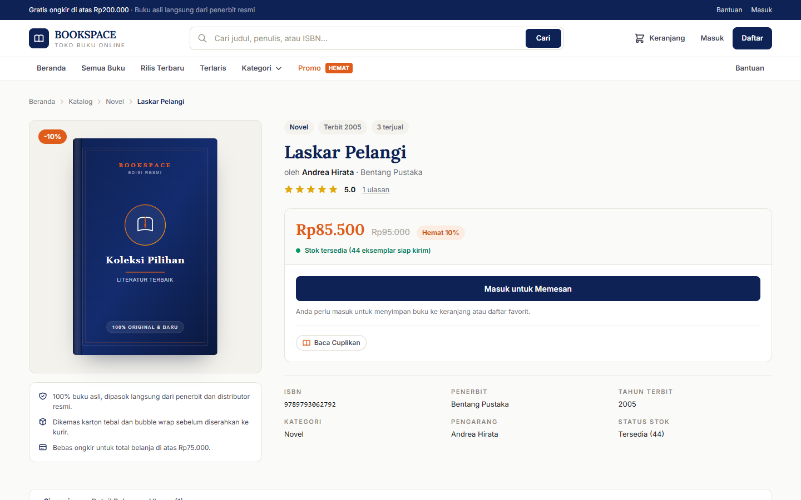
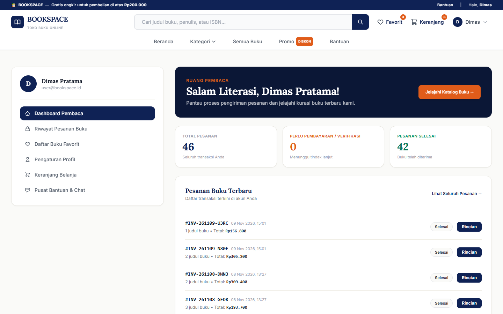
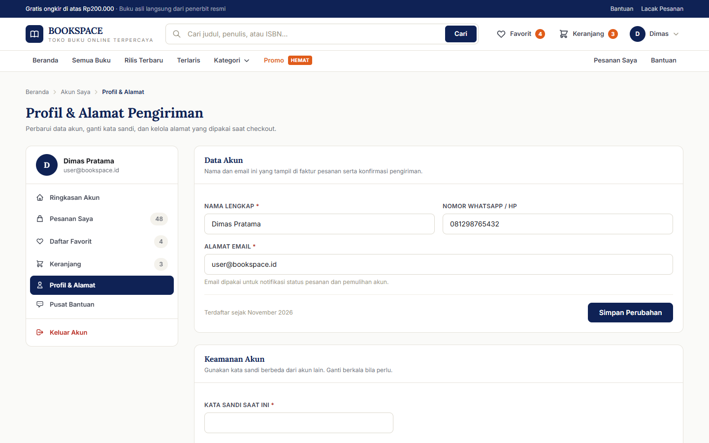
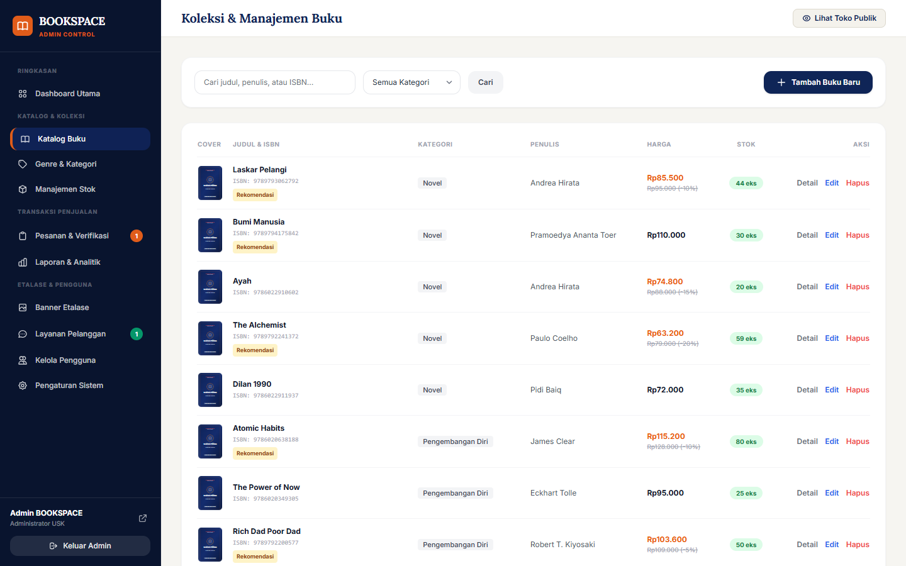
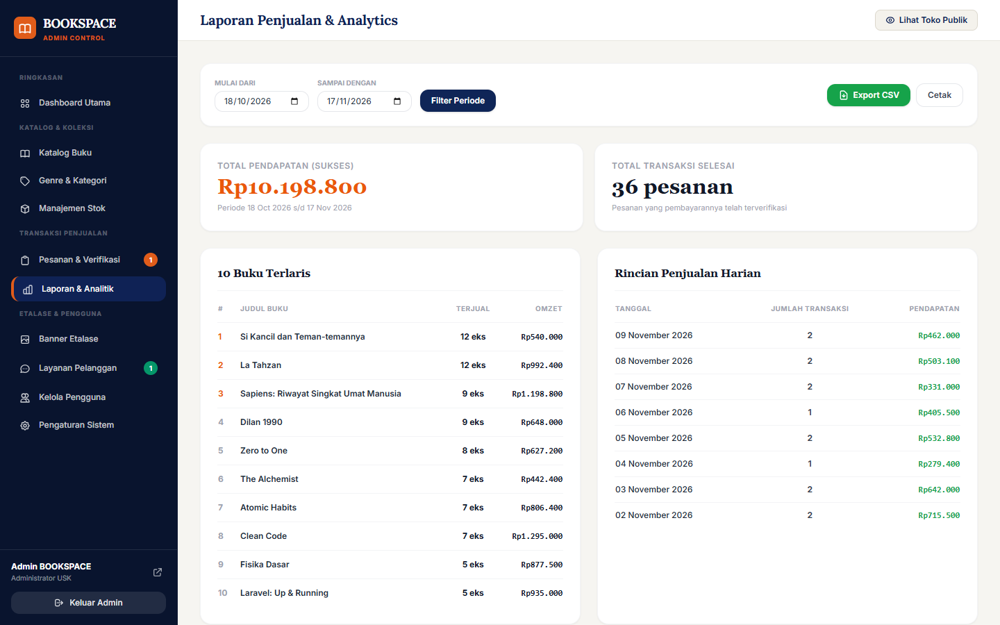
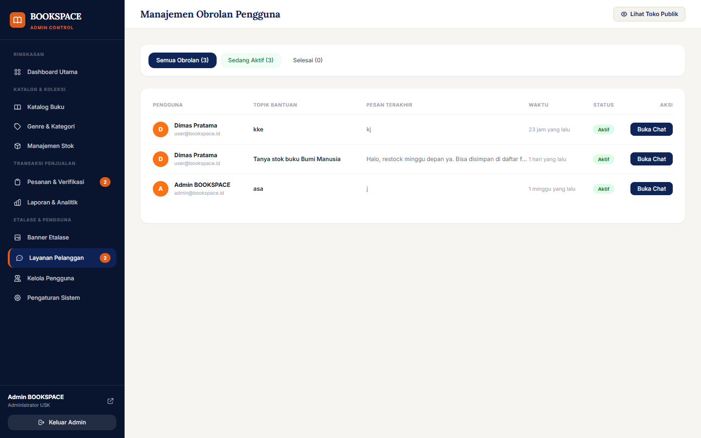
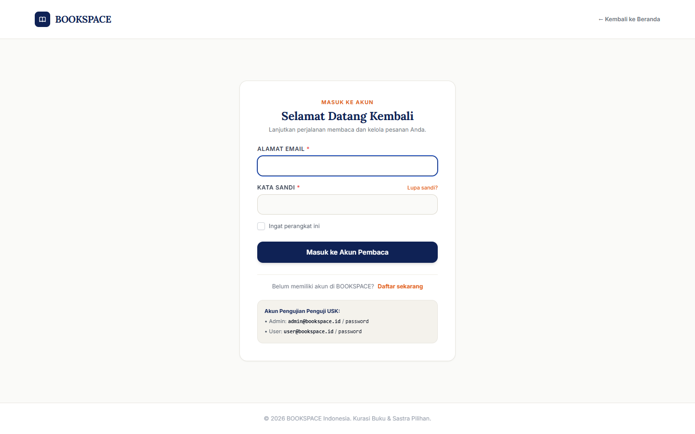

# 📚 BOOKSPACE

> Toko buku online berbasis web — dibangun dengan Laravel 13, Tailwind CSS, dan Alpine.js.

BOOKSPACE adalah aplikasi e-commerce buku lengkap dengan dua sisi: **etalase pembaca** untuk browsing, belanja, dan cek pesanan, serta **panel admin** untuk mengelola katalog, stok, transaksi, dan laporan penjualan.

---

## 🖼️ Preview

📸 **Semua screenshot:** [github.com/demzmaujadfullstack/bookspace/tree/main/preview](https://github.com/demzmaujadfullstack/bookspace/tree/main/preview)

16 tangkapan layar ini diambil langsung dari aplikasi yang berjalan (bukan mockup/desain ulang). Klik gambar mana pun untuk membuka ukuran penuh, atau buka [folder `preview/`](https://github.com/demzmaujadfullstack/bookspace/tree/main/preview) untuk melihat semuanya sekaligus.

### Etalase Pembaca

| Beranda | Katalog Buku |
| --- | --- |
| [](https://github.com/demzmaujadfullstack/bookspace/blob/main/preview/01-beranda.png?raw=true) | [](https://github.com/demzmaujadfullstack/bookspace/blob/main/preview/02-katalog-buku.png?raw=true) |
| Halaman depan dengan banner promo, kategori genre, dan rak buku terlaris. | Filter genre, rentang harga, buku diskon, dan pencarian judul/penulis/ISBN. |

| Detail Buku | Keranjang |
| --- | --- |
| [](https://github.com/demzmaujadfullstack/bookspace/blob/main/preview/03-detail-buku.png?raw=true) | [](https://github.com/demzmaujadfullstack/bookspace/blob/main/preview/04-keranjang.png?raw=true) |
| Informasi bibliografi lengkap, harga coret, stok real-time, dan ulasan pembaca. | Ubah jumlah barang, subtotal, dan estimasi ongkir. |

| Checkout | Daftar Favorit |
| --- | --- |
| [](https://github.com/demzmaujadfullstack/bookspace/blob/main/preview/05-checkout.png?raw=true) | [](https://github.com/demzmaujadfullstack/bookspace/blob/main/preview/08-favorit.png?raw=true) |
| Alamat pengiriman, metode pembayaran, dan unggah bukti transfer. | Simpan buku impian lewat tombol favorit di setiap halaman buku. |

| Dashboard Pembaca | Pesanan Saya |
| --- | --- |
| [](https://github.com/demzmaujadfullstack/bookspace/blob/main/preview/06-dashboard-akun.png?raw=true) | [](https://github.com/demzmaujadfullstack/bookspace/blob/main/preview/07-pesanan-saya.png?raw=true) |
| Ringkasan aktivitas akun dan riwayat belanja. | Lacak status pesanan dari pembayaran hingga dikirim. |

| Bantuan & Live Chat | Profil Akun |
| --- | --- |
| [](https://github.com/demzmaujadfullstack/bookspace/blob/main/preview/14-chat-bantuan.png?raw=true) | [](https://github.com/demzmaujadfullstack/bookspace/blob/main/preview/15-profil-akun.png?raw=true) |
| FAQ dan ngobrol langsung dengan tim admin. | Perbarui data diri dan alamat pengiriman. |

### Panel Admin

| Dashboard Admin | Kelola Buku |
| --- | --- |
| [](https://github.com/demzmaujadfullstack/bookspace/blob/main/preview/09-admin-dashboard.png?raw=true) | [](https://github.com/demzmaujadfullstack/bookspace/blob/main/preview/10-admin-kelola-buku.png?raw=true) |
| Statistik omzet, kurva penjualan 30 hari, dan stok menipis. | Tambah, edit, dan hapus judul buku beserta cover. |

| Transaksi | Laporan Penjualan |
| --- | --- |
| [](https://github.com/demzmaujadfullstack/bookspace/blob/main/preview/11-admin-transaksi.png?raw=true) | [](https://github.com/demzmaujadfullstack/bookspace/blob/main/preview/12-admin-laporan.png?raw=true) |
| Verifikasi bukti pembayaran dan ubah status pesanan. | Rekap penjualan dengan ekspor CSV. |

| Chat Pelanggan | Halaman Masuk |
| --- | --- |
| [](https://github.com/demzmaujadfullstack/bookspace/blob/main/preview/13-admin-chat.png?raw=true) | [](https://github.com/demzmaujadfullstack/bookspace/blob/main/preview/16-login.png?raw=true) |
| Menjawab pertanyaan pembaca secara real-time. | Autentikasi dengan Laravel Breeze. |

---

## ✨ Fitur

### Untuk Pembaca
- **Katalog & pencarian** — filter kategori genre, rentang harga, buku diskon, urutkan berdasarkan terbaru/terlaris/harga, plus pencarian judul, penulis, atau ISBN.
- **Detail buku** — informasi bibliografi (ISBN, penerbit, tahun, jumlah halaman), harga coret beserta persen diskon, status stok, dan ulasan dari pembaca lain.
- **Keranjang & checkout** — ubah jumlah item, pilih metode pembayaran, isi alamat pengiriman, lalu unggah bukti transfer.
- **Pelacakan pesanan** — status pembayaran, pengiriman, dan riwayat pesanan lengkap dengan nomor faktur.
- **Daftar favorit** — simpan buku untuk dibeli nanti.
- **Bantuan & live chat** — FAQ yang bisa dibuka-tutup dan obrolan langsung dengan admin.
- **Authentikasi** — registrasi, login, lupa password, dan profil akun (Laravel Breeze).

### Untuk Admin
- **Dashboard analitik** — total judul, kategori, pelanggan, pesanan, omzet, dan transaksi yang perlu ditindaklanjuti.
- **Kurva penjualan 30 hari** — grafik omzet harian transaksi yang sudah disetujui.
- **Manajemen katalog** — CRUD buku dan kategori genre.
- **Manajemen stok** — audit trail pergerakan stok per buku.
- **Etalase banner** — atur banner promo di beranda beserta urutan tampilannya.
- **Verifikasi pembayaran** — terima atau tolak bukti transfer, lalu perbarui status pesanan.
- **Laporan penjualan** — filter per periode dan ekspor CSV.
- **Kelola pengguna** — daftar pembaca dan detail akun.
- **Pengaturan sistem** — nama toko, ongkir gratis minimal, dan teks pengumuman.
- **Pusat bantuan** — menjawab chat pembaca dan menutup percakapan.

---

## 🧱 Tech Stack

| Lapisan | Teknologi |
| --- | --- |
| Backend | PHP 8.4, Laravel 13 |
| Database | MySQL 8 |
| Frontend | Blade, Tailwind CSS, Alpine.js, Vite |
| Autentikasi | Laravel Breeze |
| Pengujian | PHPUnit 12, Laravel Pail, Laravel Pint |

---

## 🔧 Kebutuhan Sistem

- PHP >= 8.3 (ekstensi `pdo_mysql`, `mbstring`, `openssl`, `gd`)
- Composer
- Node.js >= 20 & npm
- MySQL 8 (XAMPP/Laragon juga bisa)

---

## 🚀 Cara Menjalankan

```bash
# 1. Clone repository
git clone https://github.com/<username>/bookspace.git
cd bookspace

# 2. Install dependensi
composer install
npm install

# 3. Siapkan konfigurasi environment
cp .env.example .env
php artisan key:generate

# 4. Buat database `bookspace`, lalu sesuaikan DB_* di file .env
#    (contoh: DB_DATABASE=bookspace, DB_USERNAME=root, DB_PASSWORD=)

# 5. Jalankan migrasi dan isi data contoh
php artisan migrate --seed

# 6. Tautkan folder storage agar cover buku dan bukti transfer bisa diakses
php artisan storage:link

# 7. Bangun aset frontend
npm run build

# 8. Jalankan server
php artisan serve
```

Buka **http://127.0.0.1:8000**.

> Semua langkah di atas bisa dipangkas menjadi `composer setup` (install dependensi, `.env`, `key:generate`, migrasi, dan build aset), lalu `php artisan storage:link`.
> Untuk pengembangan dengan hot-reload assets, jalankan `npm run dev` di terminal terpisah, atau `composer run dev` untuk menjalankan server dan Vite sekaligus.

### 🔑 Akun Demo

Hasil `php artisan migrate --seed`:

| Peran | Email | Password |
| --- | --- | --- |
| Admin | `admin@bookspace.id` | `password` |
| Pembaca | `user@bookspace.id` | `password` |

---

## 📂 Struktur Proyek

```
app/
├── Http/Controllers/
│   ├── Admin/          # 10 controller panel admin
│   └── User/           # profil & pesanan pembaca
├── Models/             # 16 model (Book, Order, Payment, StockMovement, ...)
database/
├── migrations/         # 19 migrasi
└── seeders/            # data contoh: 20 buku, 10 kategori, 47 pesanan
resources/views/
├── admin/              # tampilan panel admin
├── books/ cart/ checkout/  # alur belanja pembaca
└── layouts/ components/     # tata letak & komponen Blade
preview/                # tangkapan layar aplikasi
tests/                  # 13 file pengujian unit & feature
```

---

## ✅ Pengujian

```bash
php artisan test
```

---

## 📄 Lisensi

Proyek ini dibuat untuk keperluan tugas. Framework Laravel terbuka di bawah [lisensi MIT](https://opensource.org/licenses/MIT).
