# 📚 BOOKSPACE

> Toko buku online berbasis web — dibangun dengan Laravel 13, Tailwind CSS, dan Alpine.js.

BOOKSPACE adalah aplikasi e-commerce buku lengkap dengan dua sisi: **etalase pembaca** untuk browsing, belanja, dan cek pesanan, serta **panel admin** untuk mengelola katalog, stok, transaksi, dan laporan penjualan.

---

## 🖼️ Preview

📸 **Semua screenshot:** [github.com/demzmaujadfullstack/bookspace/tree/main/preview](https://github.com/demzmaujadfullstack/bookspace/tree/main/preview)

22 tangkapan layar ini diambil langsung dari aplikasi yang berjalan (bukan mockup/desain ulang). Klik gambar mana pun untuk membuka ukuran penuh, atau buka [folder `preview/`](https://github.com/demzmaujadfullstack/bookspace/tree/main/preview) untuk melihat semuanya sekaligus.

### Etalase Pembaca

| Beranda | Katalog Buku |
| --- | --- |
| [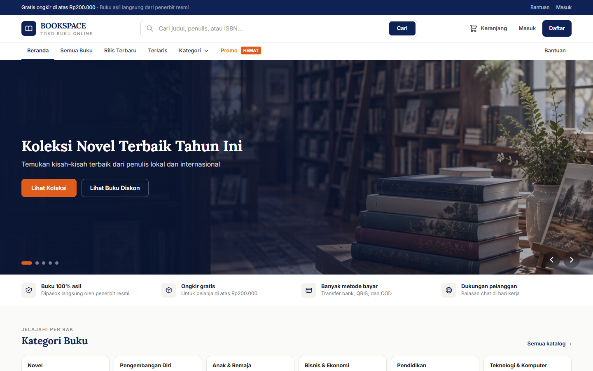](https://github.com/demzmaujadfullstack/bookspace/blob/main/preview/01-beranda.png?raw=true) | [](https://github.com/demzmaujadfullstack/bookspace/blob/main/preview/02-katalog-buku.png?raw=true) |
| Halaman depan dengan banner promo, kategori genre, dan rak buku terlaris. | Filter genre, rentang harga, buku diskon, dan pencarian judul/penulis/ISBN. |

| Detail Buku | Keranjang |
| --- | --- |
| [](https://github.com/demzmaujadfullstack/bookspace/blob/main/preview/03-detail-buku.png?raw=true) | [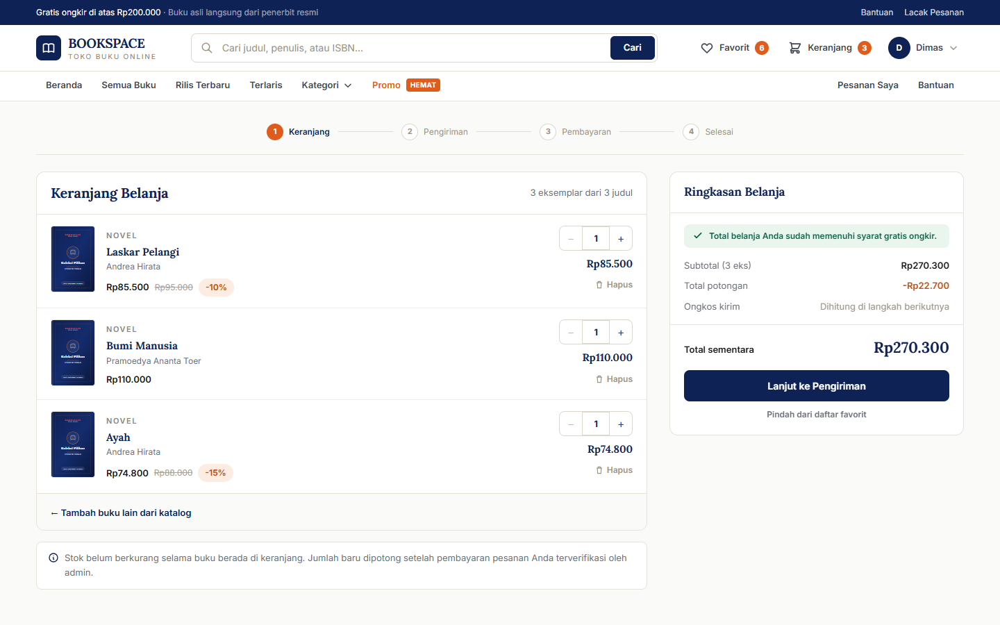](https://github.com/demzmaujadfullstack/bookspace/blob/main/preview/04-keranjang.png?raw=true) |
| Informasi bibliografi lengkap, harga coret, stok real-time, dan ulasan pembaca. | Ubah jumlah barang, subtotal, dan estimasi ongkir. |

| Checkout | Buku Alamat | Daftar Favorit |
| --- | --- | --- |
| [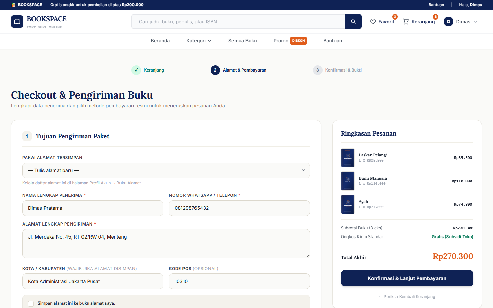](https://github.com/demzmaujadfullstack/bookspace/blob/main/preview/05-checkout.png?raw=true) | [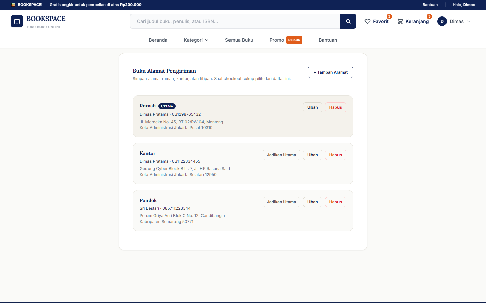](https://github.com/demzmaujadfullstack/bookspace/blob/main/preview/22-buku-alamat.png?raw=true) | [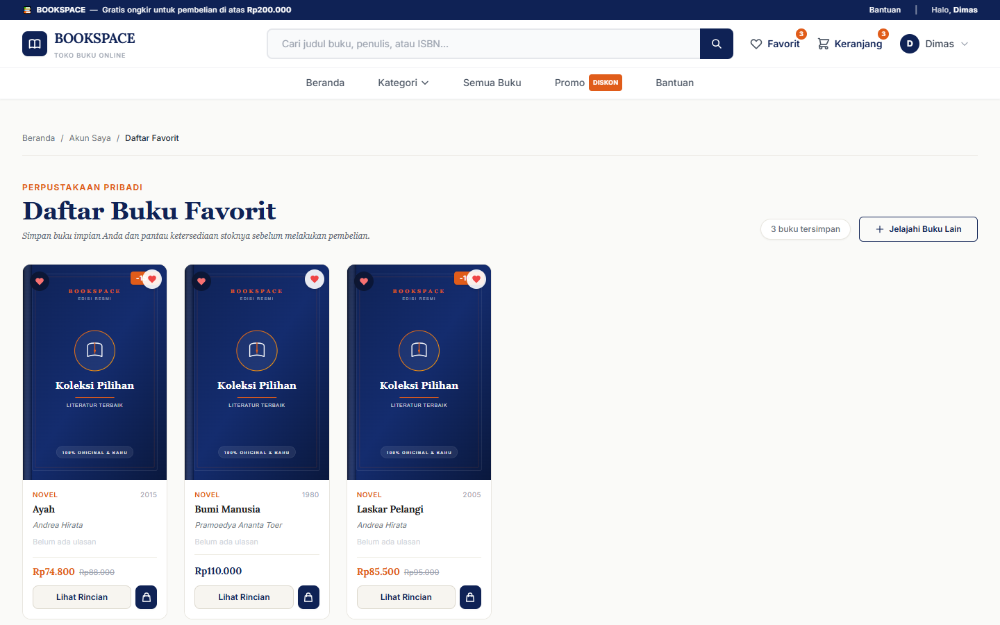](https://github.com/demzmaujadfullstack/bookspace/blob/main/preview/08-favorit.png?raw=true) |
| Pilih alamat tersimpan, lengkapi pembayaran, dan unggah bukti transfer. | Simpan alamat rumah/kantor dan tentukan alamat utama. | Simpan buku impian lewat tombol favorit di setiap halaman buku. |

| Dashboard Pembaca | Pesanan Saya |
| --- | --- |
| [](https://github.com/demzmaujadfullstack/bookspace/blob/main/preview/06-dashboard-akun.png?raw=true) | [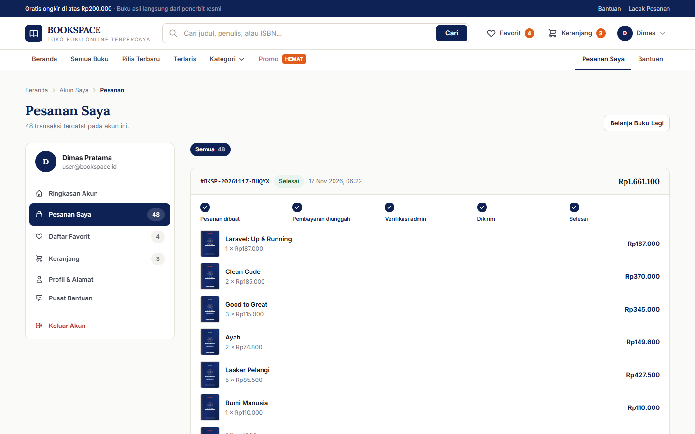](https://github.com/demzmaujadfullstack/bookspace/blob/main/preview/07-pesanan-saya.png?raw=true) |
| Ringkasan aktivitas akun dan riwayat belanja. | Lacak status pesanan, nomor resi, dan tombol konfirmasi penerimaan paket. |

| Bantuan & Live Chat | Profil Akun |
| --- | --- |
| [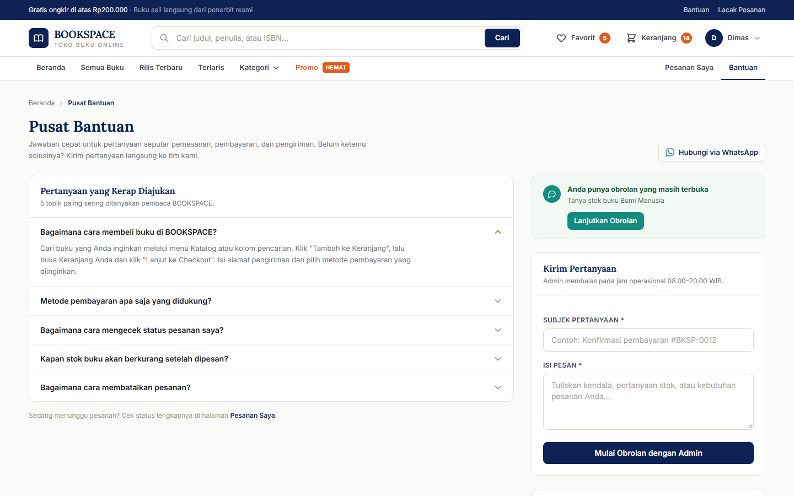](https://github.com/demzmaujadfullstack/bookspace/blob/main/preview/14-chat-bantuan.png?raw=true) | [](https://github.com/demzmaujadfullstack/bookspace/blob/main/preview/15-profil-akun.png?raw=true) |
| FAQ dan ngobrol langsung dengan tim admin. | Perbarui data diri dan kelola buku alamat pengiriman. |

### Panel Admin

| Dashboard Admin | Kelola Buku |
| --- | --- |
| [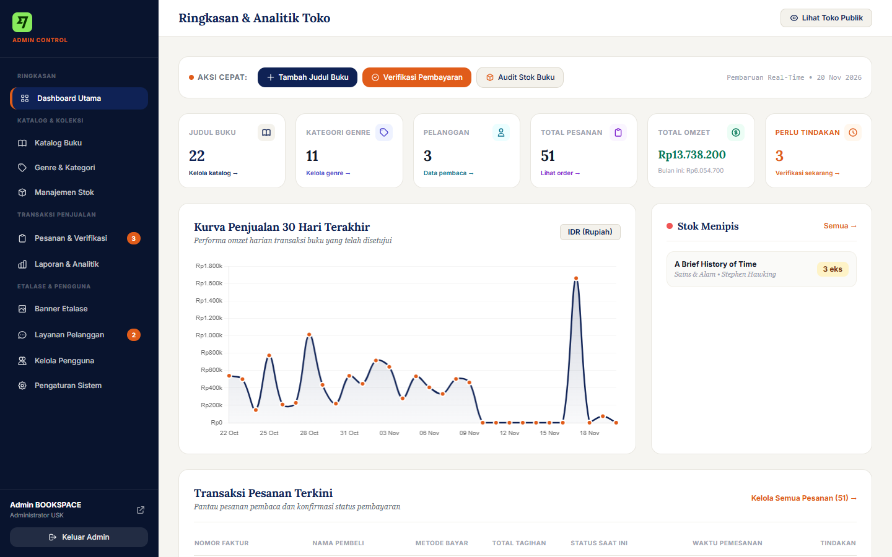](https://github.com/demzmaujadfullstack/bookspace/blob/main/preview/09-admin-dashboard.png?raw=true) | [](https://github.com/demzmaujadfullstack/bookspace/blob/main/preview/10-admin-kelola-buku.png?raw=true) |
| Statistik omzet, kurva penjualan 30 hari, dan stok menipis. | Tambah, edit, dan hapus judul buku beserta cover. |

| Transaksi | Laporan Penjualan |
| --- | --- |
| [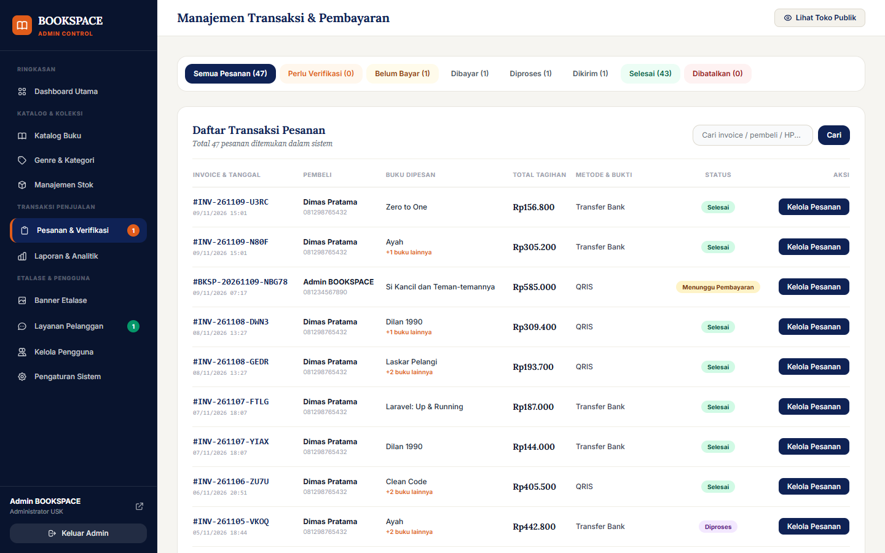](https://github.com/demzmaujadfullstack/bookspace/blob/main/preview/11-admin-transaksi.png?raw=true) | [](https://github.com/demzmaujadfullstack/bookspace/blob/main/preview/12-admin-laporan.png?raw=true) |
| Verifikasi bukti pembayaran dan ubah status pesanan. | Rekap penjualan dengan ekspor CSV. |

| Chat Pelanggan | Halaman Masuk |
| --- | --- |
| [](https://github.com/demzmaujadfullstack/bookspace/blob/main/preview/13-admin-chat.png?raw=true) | [](https://github.com/demzmaujadfullstack/bookspace/blob/main/preview/16-login.png?raw=true) |
| Menjawab pertanyaan pembaca secara real-time. | Autentikasi dengan Laravel Breeze. |

### Alur Resi & Penerimaan Paket

| Admin Tandai Dikirim | Pembaca Konfirmasi Terima |
| --- | --- |
| [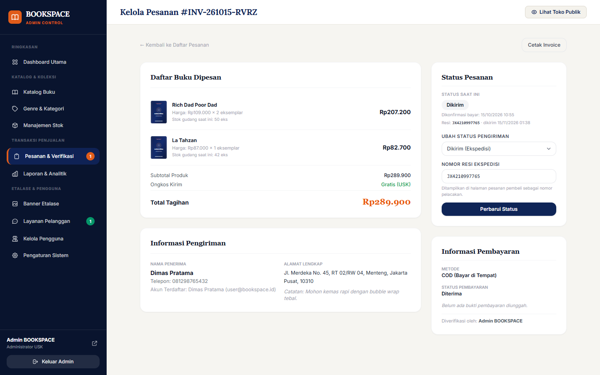](https://github.com/demzmaujadfullstack/bookspace/blob/main/preview/21-admin-resi.png?raw=true) | [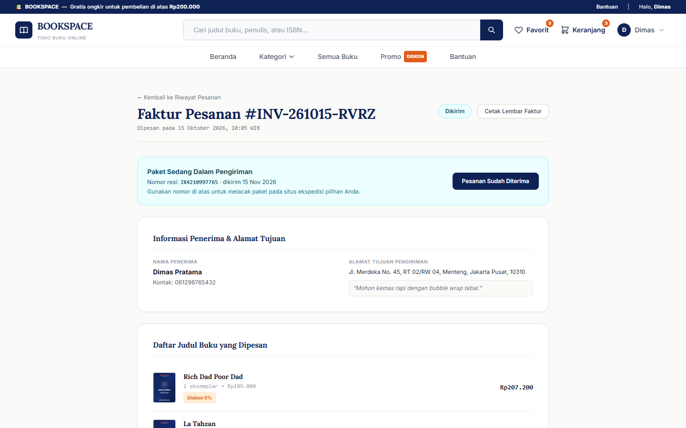](https://github.com/demzmaujadfullstack/bookspace/blob/main/preview/20-pesanan-resi.png?raw=true) |
| Nomor resi wajib diisi saat pesanan diubah menjadi Dikirim. | Resi tampil di faktur plus tombol "Pesanan Sudah Diterima". |

### Halaman Informasi Publik

| Tentang | Kebijakan Privasi | Syarat & Ketentuan |
| --- | --- | --- |
| [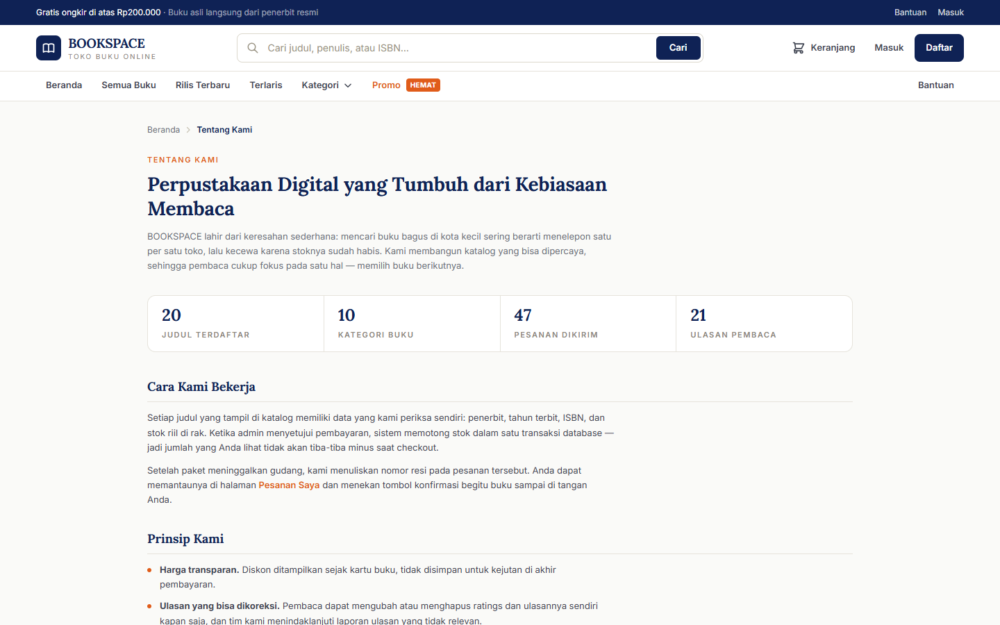](https://github.com/demzmaujadfullstack/bookspace/blob/main/preview/17-tentang.png?raw=true) | [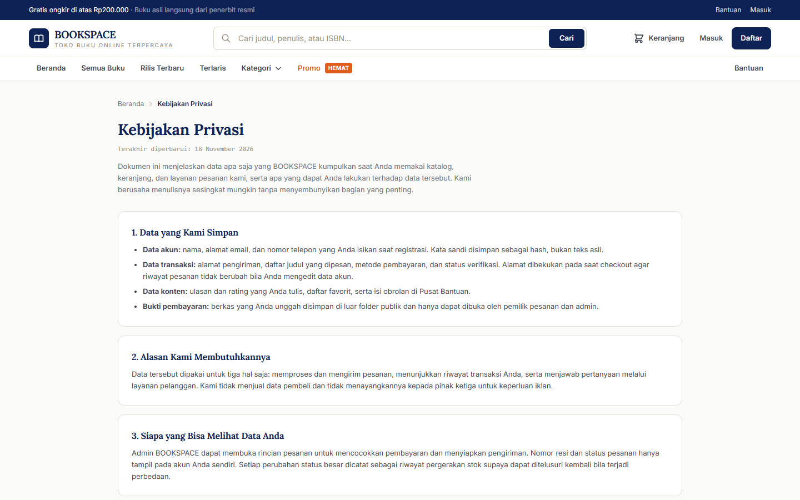](https://github.com/demzmaujadfullstack/bookspace/blob/main/preview/18-kebijakan-privasi.png?raw=true) | [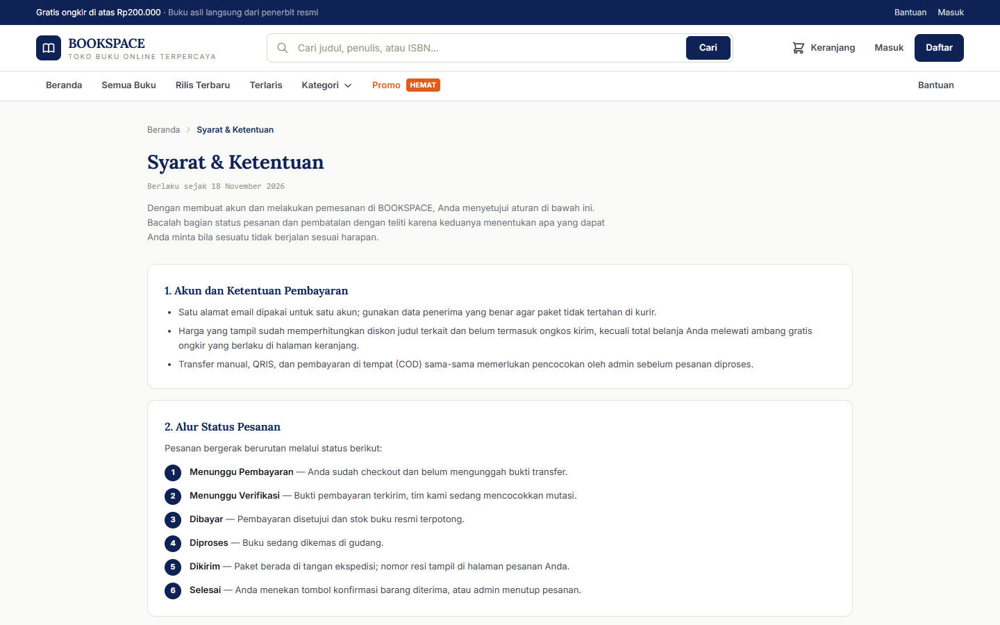](https://github.com/demzmaujadfullstack/bookspace/blob/main/preview/19-syarat-ketentuan.png?raw=true) |
| Profil toko beserta jumlah judul, kategori, ulasan, dan pesanan yang diproses. | Data apa saja yang disimpan dan siapa yang bisa melihatnya. | Aturan pembayaran, pembatalan, pengembalian dana, dan moderasi ulasan. |

---

## ✨ Fitur

### Untuk Pembaca
- **Katalog & pencarian** — filter kategori genre, rentang harga, buku diskon, urutkan berdasarkan terbaru/terlaris/harga, plus pencarian judul, penulis, atau ISBN.
- **Detail buku** — informasi bibliografi (ISBN, penerbit, tahun, jumlah halaman), harga coret beserta persen diskon, status stok, dan ulasan pembaca yang dapat diubah atau dihapus oleh penulisnya.
- **Keranjang & checkout** — ubah jumlah item, pilih alamat tersimpan atau tulis baru, centang "simpan alamat ini", pilih metode pembayaran, lalu unggah bukti transfer.
- **Buku alamat pengiriman** — simpan beberapa alamat (rumah, kantor, titipan), tandai satu sebagai utama, dan pakai lagi saat checkout tanpa menulis ulang.
- **Pelacakan pesanan** — status pembayaran dan pengiriman, nomor resi dari admin, tombol konfirmasi "Pesanan Sudah Diterima", serta riwayat pesanan lengkap dengan nomor faktur.
- **Daftar favorit** — simpan buku untuk dibeli nanti.
- **Bantuan & live chat** — FAQ yang bisa dibuka-tutup dan obrolan langsung dengan admin.
- **Authentikasi** — registrasi, login, lupa password, dan profil akun (Laravel Breeze).

### Untuk Admin
- **Dashboard analitik** — total judul, kategori, pelanggan, pesanan, omzet, dan transaksi yang perlu ditindaklanjuti.
- **Kurva penjualan 30 hari** — grafik omzet harian transaksi yang sudah disetujui.
- **Manajemen katalog** — CRUD buku dan kategori genre.
- **Manajemen stok** — audit trail pergerakan stok per buku.
- **Etalase banner** — atur banner promo di beranda beserta urutan tampilannya.
- **Verifikasi pembayaran** — terima atau tolak bukti transfer, lalu perbarui status pesanan beserta nomor resi ekspedisi.
- **Laporan penjualan** — filter per periode dan ekspor CSV.
- **Kelola pengguna** — daftar pembaca dan detail akun.
- **Pengaturan sistem** — nama toko, ambang gratis ongkir, dan teks pengumuman.
- **Pusat bantuan** — menjawab chat pembaca, dengan badge pesan baru dan konfirmasi sebelum menutup percakapan.
- **Moderasi ulasan** — menghapus ulasan yang tidak pantas dari halaman detail buku.

---

## 🔄 Alur Pesanan

Status pesanan bergerak satu arah; satu-satunya lompatan kembali adalah pembatalan yang disepakati dengan admin.

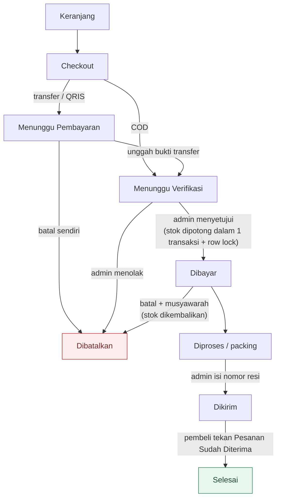

## 🗄️ Skema Database

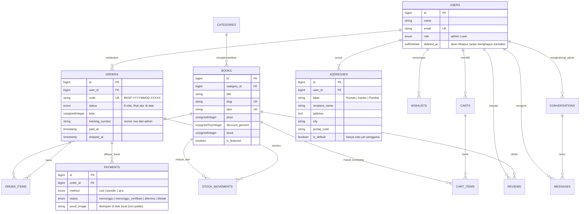

---

## 🧱 Tech Stack

| Lapisan | Teknologi |
| --- | --- |
| Backend | PHP 8.4, Laravel 13 |
| Database | MySQL 8 |
| Frontend | Blade, Tailwind CSS, Alpine.js, Vite |
| Autentikasi | Laravel Breeze |
| Pengujian | PHPUnit 12, Laravel Pail, Laravel Pint |

---

## 🔧 Kebutuhan Sistem

- PHP >= 8.3 (ekstensi `pdo_mysql`, `mbstring`, `openssl`, `gd`)
- Composer
- Node.js >= 20 & npm
- MySQL 8 (XAMPP/Laragon juga bisa)

---

## 🚀 Cara Menjalankan

```bash
# 1. Clone repository
git clone https://github.com/<username>/bookspace.git
cd bookspace

# 2. Install dependensi
composer install
npm install

# 3. Siapkan konfigurasi environment
cp .env.example .env
php artisan key:generate

# 4. Buat database `bookspace`, lalu sesuaikan DB_* di file .env
#    (contoh: DB_DATABASE=bookspace, DB_USERNAME=root, DB_PASSWORD=)

# 5. Jalankan migrasi dan isi data contoh
php artisan migrate --seed

# 6. Tautkan folder storage agar cover buku dan bukti transfer bisa diakses
php artisan storage:link

# 7. Bangun aset frontend
npm run build

# 8. Jalankan server
php artisan serve
```

Buka **http://127.0.0.1:8000**.

> Semua langkah di atas bisa dipangkas menjadi `composer setup` (install dependensi, `.env`, `key:generate`, migrasi, dan build aset), lalu `php artisan storage:link`.
> Untuk pengembangan dengan hot-reload assets, jalankan `npm run dev` di terminal terpisah, atau `composer run dev` untuk menjalankan server dan Vite sekaligus.

### 🔑 Akun Demo

Hasil `php artisan migrate --seed`:

| Peran | Email | Password |
| --- | --- | --- |
| Admin | `admin@bookspace.id` | `password` |
| Pembaca | `user@bookspace.id` | `password` |

---

## 📂 Struktur Proyek

```
app/
├── Http/Controllers/
│   ├── Admin/          # 10 controller panel admin
│   └── User/           # profil, pesanan & pusat bantuan pembaca
├── Models/             # 16 model (Book, Order, Payment, StockMovement, ...)
database/
├── migrations/         # 21 migrasi
└── seeders/            # data contoh: 20 buku, 10 kategori, 47 pesanan, 5 banner, ±21 ulasan, 3 alamat
resources/views/
├── admin/              # tampilan panel admin
├── books/ cart/ checkout/ user/  # alur belanja pembaca
├── pages/              # tentang, kebijakan privasi, syarat & ketentuan
└── layouts/ components/ # tata letak & komponen Blade (book-card, review-form, breadcrumbs, ...)
preview/                # tangkapan layar aplikasi
routes/web.php          # 102 route
tests/                  # 17 file pengujian unit & feature
```

---

## ✅ Pengujian

```bash
php artisan test          # 65 tes, 194 assertion (sqlite in-memory)
vendor/bin/pint           # perbaiki gaya kode
vendor/bin/pint --test    # periksa tanpa mengubah
```

Cakupan tes yang paling penting: `OrderLifecycleTest` (keranjang → checkout → bukti transfer → verifikasi admin → resi → konfirmasi terima), `StockAndTransactionTest` (stok hanya berubah saat pembayaran disetujui), `ShippingTrackingTest` (resi wajib saat dikirim + hak konfirmasi pembeli), `UserAddressTest` (buku alamat, alamat utama, dan prefill checkout), `WishlistAndReviewTest` (ubah/hapus ulasan dan paginasi daftar), `AdminAccessTest` (pemisahan hak admin/pembaca), `StaticPageTest`, dan rangkaian `Auth/*` bawaan Breeze.

---

## 🔒 Catatan Keamanan

Temuan audit yang sudah diperbaiki:

| Area | Perbaikan |
| --- | --- |
| Live chat | Isi pesan di-escape sebelum tampil; tidak ada lagi `innerHTML` pada balasan, sehingga stored XSS tidak dapat berjalan. |
| Bukti transfer | Pindah dari `storage/app/public` ke disk `local` (tidak bisa diakses langsung). Berkas disajikan lewat route yang memeriksa pemilik pesanan dan admin. |
| Ekspor CSV laporan | Nilai yang diawali `=`, `+`, `-`, `@`, tab, atau CR diberi prefiks pelindung agar tidak dieksekusi Excel sebagai formula. |
| Filter tanggal laporan | Format `YYYY-MM-DD` divalidasi sebelum masuk query. |
| Mass assignment | Kolom `role` dikeluarkan dari `$fillable` pengguna; kenaikan hak akses lewat form tidak mungkin. |
| Rate limiting | `throttle` pada login, pencarian, dan pengiriman chat. |
| SQL | Tidak ada string concatenation di query; filter memakai binding. |

Catatan yang belum ditindaklanjuti (disengaja, karena di luar lingkup tugas):
- Belum ada 2FA dan belum ada enkripsi at-rest untuk alamat/nomor telepon (masih plaintext di DB).
- Bukti pembayaran tidak di-*scan* isi gambarnya; siapa pun yang punya tautan sah tetap bisa mengunggah berkas apa pun selama tipenya gambar.

---

## ⚡ Catatan Performa

Sebelum vs sesudah perbaikan (jumlah query MySQL per permintaan, diukur dengan `DB::listen`, bukan perkiraan):

| Halaman | Sebelum | Sesudah |
| --- | --- | --- |
| Beranda | 36 | 14 |
| Katalog | 23 | 4 |
| Detail buku | 14 | 6 (tamu) / 10 (login) |
| Daftar favorit | 13 | 8 |
| Admin → stok | 21 | 7 |
| Admin → dashboard | ±45 | 16 |

Yang dilakukan:
- **Eager loading** (`forCards()`) untuk kategori + agregat rating di semua kartu buku; `withCount` menggantikan query per baris.
- **Memo per permintaan** untuk wishlist pengguna dan daftar kategori navbar, alih-alih query berulang.
- **Cache ringan** untuk settings (array scalar, TTL 5 menit) dan otomatis disegarkan lewat model event; Eloquent Collection sengaja tidak di-cache karena Laravel 13 menolak deserialisasi objek dari cache.
- **Index baru** untuk filter katalog, stok, diskon, `is_featured`, dan pasangan `[book_id, rating]` pada review; pemilihan index diverifikasi dengan `EXPLAIN`, bukan diasumsikan.
- **Query agregat** (`GROUP BY status`, `DATE(created_at)`) menggantikan belasan query `count()` per filter status di panel admin.

---

## 🧾 Batasan Proyek

- **Pembayaran belum terhubung gateway.** QRIS dan transfer hanya pencatatan manual: admin mencocokkan mutasi lalu menyetujui bukti yang diunggah. Tidak ada webhook, tidak ada rekonsiliasi otomatis.
- **Ongkir tidak dihitung dari kurir.** Ongkos kirim memakai tarif tetap yang dikonfigurasi admin; tidak ada integrasi API kurir untuk ongkir real-time.
- **Otomasi email memakai log.** `MAIL_MAILER=log` (bawaan `.env.example`), jadi tautan *reset password* dan notifikasi tidak dikirim ke inbox — isinya ditulis ke `storage/logs/laravel.log`. Untuk mengirim sungguhan, isi `MAIL_*` dengan SMTP/Resend dan ubah mailer-nya.
- **Nomor resi tidak dilacak otomatis.** Resi ditampilkan apa adanya; pengecekan status paket masih harus dibuka di situs ekspedisi.
- **Pengembalian dana tidak ada.** Pesanan yang sudah dibayar dapat dibatalkan, tetapi proses refund dilakukan di luar sistem.
- **Data contoh, bukan data produksi.** 20 buku, 10 kategori, dan 47 pesanan berasal dari seeder; cover buku juga dihasilkan sebagai SVG.
- **Belum ada multi-toko/warehouse & perpajakan.** Satu admin, satu gudang, tanpa faktur pajak.
- **Ulasan terbuka untuk semua pengguna login.** Syarat "hanya pembeli yang boleh ulasan" belum ditegakkan; moderasi dilakukan manual oleh admin.

---

## 📄 Lisensi

Proyek ini dibuat untuk keperluan tugas. Framework Laravel terbuka di bawah [lisensi MIT](https://opensource.org/licenses/MIT).
